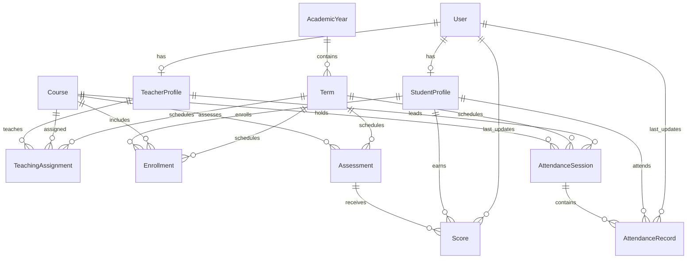

# Data model and authorization

The implemented schema covers the retained account, profile, academic period,
course, assignment, enrolment, assessment, score, and attendance requirements.
Administrator is a user role, not a duplicate identity table. Age is calculated.
Foreign keys are indexed by Django; unique identifiers and composite uniqueness
constraints support lookup and prevent duplicate enrolments and academic records.
First/last-name indexes are added for student search. Search uses case-insensitive
prefix matching; index use depends on backend/collation and is not a guarantee of
substring-search performance. Student number already has a unique index.

Database constraints protect choices, duplicate records, dates, weights, and
nonnegative scores. Cross-table validation protects assessment maximums,
enrolment eligibility, teacher assignments, and role-profile consistency. New
academic record models validate on save; bulk updates bypass these cross-table
rules. A review defect involving malformed decimal values masking ValidationError
with an arithmetic exception was fixed and covered by a regression test.

`accounts.policies.visible_students` is the authorization boundary used by both
student views. Teachers require an enrolment and teaching assignment in the SAME
course and term; withdrawn enrolments are excluded. Students see their own profile;
active administrators see all profiles. Authentication and role checks occur before
any lookup. Existing unauthorized profiles produce 403; missing profiles produce
404 without displaying private fields. Navigation visibility is only a convenience.

Record query helpers scope through visible students and relevant
course/term assignments before fetching results. Model updater checks do not replace
view authorization. Student-facing pages expose approved profile fields only, with
no passwords, email addresses, staff flags, or login metadata.

The review is a local functional checkpoint, not a deployment certification.
Latest-updater attribution is not a complete historical revision log. Assignment
sections are labels rather than a section-level enrolment permission boundary.
Student list pagination is fixed at 20 results; search inputs are limited to 100
characters. Record lists have 50 rows per page; see [operations](operations.md)
for benchmarks, query counts and restore verification.
